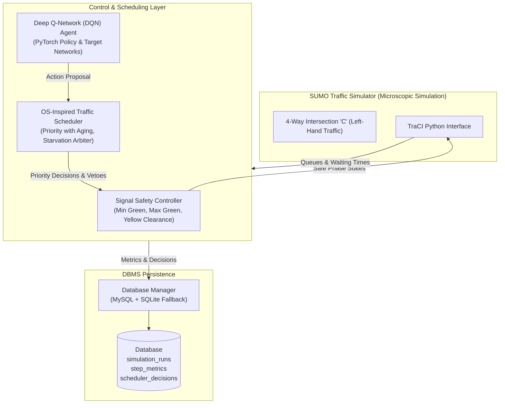

# Smart Traffic Management System Using OS-Based Real-Time Process Scheduling

**Team Name:** StructMinds  
**Team Leader:** Ayush Gaur  
**Team Members:** Vedansh Manwal, Anmol Pujari  
**GitHub Repository:** [Smart-Traffic-Management-System-Using-OS-Based-Real-Time-Process-Scheduling](https://github.com/AyushGaur07/Smart-Traffic-Management-System-Using-OS-Based-Real-Time-Process-Scheduling)  
**Evaluation Scope:** Phase-II Project Evaluation (~90% complete)

---

## 1. Project Overview & Problem Statement
Conventional traffic signal systems operate on rigid, fixed-time cycles or simplistic vehicle-actuated timers. During asymmetrical traffic surges, these static schedules cause prolonged idle green times for empty lanes and excessive queuing on congested approaches, increasing vehicle delay, fuel waste, and carbon emissions.

This project delivers an integrated **Smart Traffic Management System** controlling a 4-way intersection (configured for left-hand traffic as per Indian road standards). It combines:
1. **Operating Systems (OS) Principles:** Treating traffic approaches as processes scheduled dynamically using dynamic priority, aging, and anti-starvation preemption.
2. **Artificial Intelligence (Reinforcement Learning):** Employing a Deep Q-Network (DQN) with experience replay and target networks to learn green-time allocation.
3. **Database Management Systems (DBMS):** Persisting run metrics, step observations, scheduler decisions, and environmental stats using MySQL (with an automatic SQLite fallback).
4. **Safety & Clearance Layer:** Enforcing minimum green, maximum green, and yellow clearance intervals so that conflicting traffic streams never collide.

---

## 2. Operating Systems Concepts in Traffic Control
The intersection is mapped directly onto fundamental OS CPU scheduling concepts:

| Operating System Concept | Traffic Simulation Analog | Implementation in Project |
| :--- | :--- | :--- |
| **Ready Processes / Threads** | Directional Traffic Approaches (NS and EW flows) | `TrafficProcess` instances tracking queue and waiting state. |
| **CPU Time Slice / Quantum** | Green Signal Duration | Minimum green (10s) and maximum green (60s) constraints. |
| **Process Priority** | Approach Queue Length (Halting Vehicles) | Dynamic calculation: $Priority = w_q \times Queue + w_a \times Age$. |
| **Aging & Starvation Prevention** | Time vehicles wait at red light | As waiting time increases, the approach's priority increases dynamically, preventing indefinite waiting. |
| **Context Switch Overhead** | Yellow Transition Interval (Clearance Time) | 3-second yellow clearance penalty preventing thrashing. |
| **Arbitration / Veto Kernel** | OS Safety Arbiter over User-level Processes | The OS scheduler arbitrates AI agent decisions; if a lane is starved beyond threshold, the OS vetoes the AI to guarantee fairness. |

---

## 3. System Architecture



---

## 4. Signal Program & Phase Mapping
For junction `C`, the 16 controlled signal links represent the following movements:
- **South Approach (`S_C`)**: Link 0 (Turn Left), Link 1 (Straight), Link 2 (Turn Right), Link 3 (U-turn)
- **East Approach (`E_C`)**: Link 4 (Turn Left), Link 5 (Straight), Link 6 (Turn Right), Link 7 (U-turn)
- **North Approach (`N_C`)**: Link 8 (Turn Left), Link 9 (Straight), Link 10 (Turn Right), Link 11 (U-turn)
- **West Approach (`W_C`)**: Link 12 (Turn Left), Link 13 (Straight), Link 14 (Turn Right), Link 15 (U-turn)

### Safe Phase Definitions:
- **Phase 0 (NS Green):** `GGggrrrrGGggrrrr` (North-South movements permitted)
- **Phase 1 (NS Yellow):** `yyyyrrrryyyyrrrr` (3-second yellow clearance)
- **Phase 2 (EW Green):** `rrrrGGggrrrrGGgg` (East-West movements permitted)
- **Phase 3 (EW Yellow):** `rrrryyyyrrrryyyy` (3-second yellow clearance)

*Safety invariant:* Non-conflicting streams move together. The Signal Safety Controller strictly rejects any phase change until the minimum green time (10s) and yellow clearance (3s) are respected.

---

## 5. Investigation and Resolution of the "Zero-Arrival" Issue
In previous baseline tests, the output reported `Vehicles arrived: 0`. 
- **Cause Identified:** In TraCI, `traci.simulation.getArrivedNumber()` returns the number of vehicles that reached their destination **during that single step only**. Calling `traci.simulation.getArrivedNumber()` only once at the conclusion of the simulation measured strictly whether a car arrived in the final second (t = 300s).
- **Fix Implemented:** We modified the simulation loops (`run_baseline.py`, `sumo_env.py`, `evaluator.py`, and `run_experiment.py`) to accumulate arrivals and departures step-by-step.
- **Verification:** Over a 300-second run with 100 departed vehicles, 77 to 85 vehicles successfully completed their journeys and arrived at their destinations.

---

## 6. Experimental Benchmark Evaluation
All 4 control strategies were evaluated under identical conditions (300 seconds, SUMO random seed 42, moderate traffic demand of 100 departed vehicles):

| Strategy | Vehicles Arrived | Vehicles Departed | Max Queue (Veh) | Mean Queue (Veh) | Stopped Vehicle-Sec | Total CO2 (g) | Throughput (Veh/Hour) |
| :--- | :---: | :---: | :---: | :---: | :---: | :---: | :---: |
| **1. Fixed-Time** | 77 | 100 | 15 | 5.360 | 1608 | 11559.5 | 924.0 |
| **2. OS Adaptive** | 82 | 100 | 8 | 1.917 | 575 | 10129.1 | 984.0 |
| **3. Pure DQN** | 82 | 100 | 8 | 2.693 | 808 | 10345.9 | 984.0 |
| **4. DQN + OS Scheduling** | **85** | 100 | **7** | 2.413 | 724 | 10477.4 | **1020.0** |

### Key Observations:
1. **OS Adaptive Priority Scheduling with Aging** achieved the lowest stopped vehicle-seconds (575s vs. 1608s, a **64.2% reduction in idling delay**) by allocating green time directly where queues existed.
2. **DQN + OS Layer** achieved the highest overall throughput (**85 arrivals / 1020 veh/hr**) and the lowest peak queue length (7 vehicles), because the OS scheduler arbitrated against starvation while allowing the neural network to handle dynamic transitions.
3. Emissions dropped by over 1,000 grams of CO2 compared to the fixed-time baseline.

---

## 7. Installation & Quick Start

### Prerequisites
- Python 3.10+ (tested on Python 3.14)
- Eclipse SUMO 1.27+ installed at `C:\Program Files (x86)\Eclipse\Sumo`

### Virtual Environment & Dependencies
```powershell
# Navigate to project directory
cd D:\SmartTrafficSimulator

# Activate virtual environment
.\.venv\Scripts\Activate.ps1

# Install requirements
pip install -r requirements.txt
```

### Running the Application

#### 1. Interactive Viva Demonstration CLI
```powershell
python main.py
```
Presents a simple numbered menu allowing live simulation runs with or without SUMO graphical GUI, training, benchmark suite execution, and chart updates.

#### 2. Run Comprehensive 4-Controller Benchmark
```powershell
python main.py --mode benchmark --seconds 300 --seed 42
```

#### 3. Run with SUMO GUI Visualizer
```powershell
python main.py --mode run --controller dqn_os --seconds 300 --gui
```

#### 4. Train Deep Q-Network (DQN)
```powershell
python main.py --mode train --episodes 10 --seconds 300
```

#### 5. Run Automated Unit Tests
```powershell
python -m unittest tests/test_traffic_system.py
```

---

## 8. Database Management (MySQL & SQLite)
- The project includes `src/database/db_manager.py` with full transactional support and parameterized SQL queries.
- Configure credentials by copying `.env.example` to `.env`:
  ```ini
  DB_TYPE=mysql
  DB_HOST=localhost
  DB_PORT=3306
  DB_USER=root
  DB_PASSWORD=your_password
  DB_NAME=smart_traffic_db
  ```
- If MySQL is not running or credentials fail, the system automatically falls back to SQLite (`results/traffic_results.sqlite3`) with identical schemas, ensuring zero crashes during live presentations.

---

## 9. Current Phase-II Status & Future Scope
- **Completion Status:** ~90% of planned Phase-II deliverables achieved.
- **Completed Components:**
  - Validated left-hand 4-way SUMO intersection.
  - OS-inspired priority scheduling with starvation aging.
  - PyTorch Deep Q-Network (DQN) with experience replay and target networks.
  - Signal Safety Controller enforcing yellow clearance and min/max green times.
  - Dual database storage (MySQL + SQLite fallback).
  - Repeatable 4-controller benchmarking and chart plotting.
  - 10 automated unit & integration tests passing.
  - Unified CLI runner (`main.py`).
- **Future Scope (Phase-III):**
  - Expanding from a single isolated junction to a coordinated multi-intersection corridor.
  - Integration of emergency vehicle priority preemption (Interrupt handling analog).
  - Multi-agent reinforcement learning (MARL) for synchronized corridor flow.
